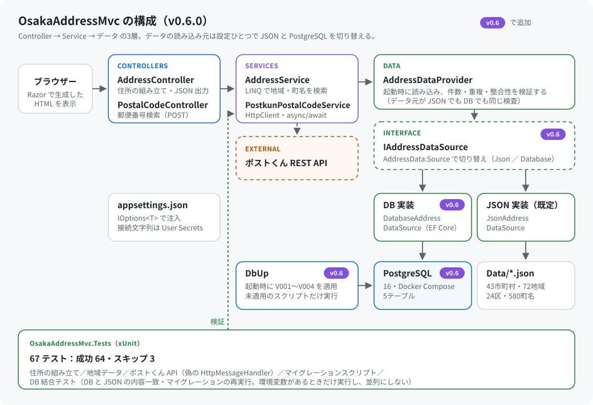
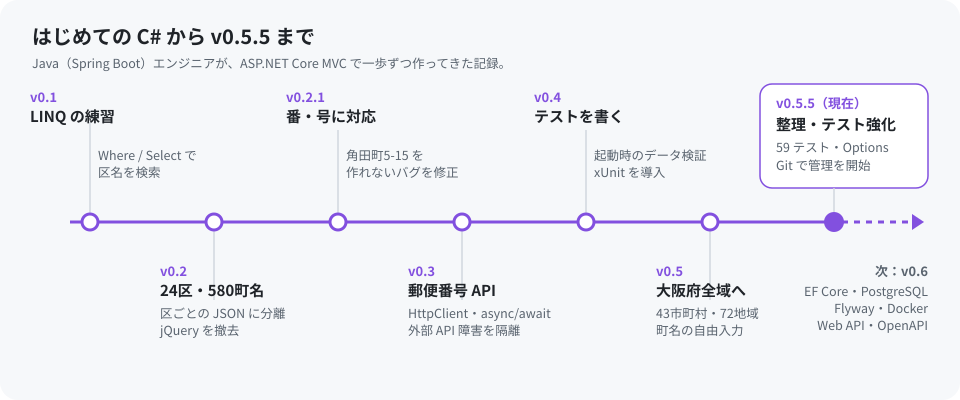

# FirstDotNetWebTrial

**Java エンジニアが、C# をまったく知らない状態から作った、はじめての ASP.NET Core Web アプリケーション**


長く Java（Spring Boot）で仕事をしてきましたが、C# と .NET に触れるのはこれが初めてです。入社後の研修期間に、Microsoft Learn を見ながら **LINQ の練習** として小さな住所検索を作り始め、気づけば大阪府全域の住所を扱い、自動テストまで備えたアプリになりました。

このリポジトリは、その「最初の一歩」の記録です。

---

## 何ができるか

大阪府の **43市町村・72地域**（大阪市24区・堺市7区・その他の市町村）から地域を選び、町名・丁目・番・号を指定して住所を組み立てます。

- 例：大阪市北区 → 角田町 → 番 `5`・号 `15` → **`大阪府大阪市北区角田町5-15`**
- 例：島本町 → 桜井 → 丁目 `2` → **`大阪府三島郡島本町桜井2丁目`**（郡名を自動で付与）
- 全角数字は半角に統一し、存在しない丁目や「号だけ」の入力は受け付けません。
- 組み立てた住所や、府内の全データを JSON でダウンロードできます。
- 公開 REST API「ポストくん」で、町名から郵便番号を検索できます（API が落ちていても住所検索は動きます）。

## 構成



| 分類 | 使用技術 |
| --- | --- |
| 言語・ランタイム | C# 14 / .NET 10 |
| Web | ASP.NET Core MVC、Razor、Bootstrap 5.3（jQuery なし） |
| 外部連携 | `HttpClient`（Typed Client）、`async` / `await`、ポストくん REST API |
| 設定 | `appsettings.json` + Options パターン（`IOptions<T>`） |
| テスト | xUnit、偽の `HttpMessageHandler`、環境変数で実行を切り替える独自属性 `[DatabaseFact]` |
| データ | JSON（大阪府の市町村一覧、大阪市24区・580町名） |

## 歩み



| バージョン | やったこと |
| --- | --- |
| v0.1 | LINQ（`Where` / `Select` / `Distinct`）の練習として、大阪市の区名検索を作る |
| v0.2 | 24区・580町名を区ごとの JSON に分離。jQuery を外し、標準の JavaScript だけにする |
| v0.2.1 | 丁目のない町（角田町など）で番・号を入力できないバグを修正 |
| v0.3 | 郵便番号検索を追加。外部 API の障害が既存の住所検索に影響しない構成にする |
| v0.4 | 起動時のデータ検証、`JsonSerializerOptions` の再利用、xUnit による自動テスト |
| v0.5 | 対象を大阪市24区から大阪府全域（43市町村・72地域）へ拡張 |
| **v0.5.5** | 設定の外部化（Options）、ポストくん API のテスト、DB 接続テストの安全化、不要ファイルの整理、Git での管理を開始 |

## Java エンジニアの目で見た C#

文法はすぐに読めました。つまずいたのは、言語そのものより「周りの習慣」の違いです。

| 気づいたこと | Java / Spring Boot では | C# / ASP.NET Core では |
| --- | --- | --- |
| テストの置き場所 | 同じモジュールの `src/test/java` | **別プロジェクト**。Web プロジェクトのフォルダーの外に置かないとビルドが壊れる |
| 複数プロジェクトのまとめ方 | 親 pom / `settings.gradle` | ソリューション（`.slnx`） |
| アノテーション | インターフェースの一種。継承できない | 属性（Attribute）は**クラス**。`FactAttribute` を継承して `[DatabaseFact]` を作れた |
| getter / setter | Lombok に頼ることが多い | プロパティ `{ get; set; }` と `record` が言語に組み込み |
| 設定のバインド | `@ConfigurationProperties` | `IOptions<T>` |
| HTTP のタイムアウト | `HttpTimeoutException` | `TaskCanceledException`。利用者の取り消しと**同じ型**で届くので区別が必要 |
| 古いビルド成果物 | `target/` → `mvn clean` | `bin/` `obj/` を削除。古いデータファイルが残り、起動時検証で重複エラーになった |

## つまずいて学んだこと

うまくいかなかったことも、そのまま残しておきます。

- **テストプロジェクトを Web プロジェクトの中に作ってしまった**：Web 側がテストのソースまでコンパイルしてビルドが失敗。ソリューションの直下に並べて解決。
- **古いバージョンのテストを新しいコードに上書きした**：`CS1061`（メソッドが見つからない）で失敗。テストは本体と同じバージョンで管理するものだと実感した。
- **アーカイブを古いフォルダーの上に展開した**：`bin/` に旧ファイルが残って「区名が重複しています」、削除したはずのファイルもそのままコミットされていた。今は Git で管理している。
- **DB の疎通確認テストにパスワードを書いていた**：環境変数から読むように変更し、未設定ならスキップする属性を作った。

エラーメッセージとスタックトレースを読んで、「環境の問題か、コードの問題か」を切り分ける練習にもなりました。

## 動かし方

[.NET 10 SDK](https://dotnet.microsoft.com/download) が必要です。

```powershell
git clone https://github.com/john911120/FirstDotNetWebTrial.git
cd FirstDotNetWebTrial

dotnet test                                # 自動テスト（59件中58件成功・DB 接続テストの1件はスキップ）
dotnet run --project OsakaAddressMvc       # 表示された https://localhost:xxxx を開く
```

DB の疎通確認テストは、接続文字列を環境変数で渡したときだけ実行されます。

```powershell
$env:OSAKA_TEST_DB = "Host=localhost;Port=5432;Database=...;Username=...;Password=..."
dotnet test --filter "Category=Integration" --logger "console;verbosity=detailed"
Remove-Item Env:OSAKA_TEST_DB
```

## フォルダー構成

```text
FirstDotNetWebTrial/
├── OsakaAddress.slnx          # ソリューション
├── OsakaAddressMvc/           # Web アプリ本体（詳しい説明は OsakaAddressMvc/README.md）
├── OsakaAddressMvc.Tests/     # xUnit テスト
└── docs/images/               # この README の図
```

アプリの詳しい仕様、各バージョンの変更内容、データの出典は [OsakaAddressMvc/README.md](OsakaAddressMvc/README.md)、確認手順は [OsakaAddressMvc/TEST_PLAN.md](OsakaAddressMvc/TEST_PLAN.md) にまとめています。

## 次の目標（v0.6）

- EF Core と PostgreSQL を導入し、JSON のデータを DB に移す
- Flyway でスキーマを管理し、Docker Compose で DB・マイグレーション・アプリをまとめて起動する
- 住所を正規化する Web API を追加し、OpenAPI で公開する
- 同じ API を Spring Boot でも作り、Java と C# を並べて比べる

## 参考にしたもの

- [Microsoft Learn（.NET / ASP.NET Core のドキュメント）](https://learn.microsoft.com/ja-jp/dotnet/)
- [++C++; // 未確認飛行 C](https://ufcpp.net/)（C# の解説サイト）
- [ポストくん REST API](https://postcode.teraren.com/doc)
- [大阪市 区別町名一覧](https://www.city.osaka.lg.jp/shimin/page/0000061040.html)

## 注意事項

学習用のプロジェクトです。住所データは公開情報をもとに手作業で構造化したもので、公式の住所マスタではありません。大阪市外の町名は形式のみを検査しており、実在性は確認していません。郵便番号検索の利用条件はポストくんの[利用規約](https://postcode.teraren.com/terms)に従ってください。
